# sample-medical-app-builder

**Governed clinical applications from plain language, on AWS.** A clinician describes an app — *"blood pressure over the
last two years against the Stage 1 thresholds, for GPs and cardiologists"* — and a drafting assistant on Amazon Bedrock
turns the conversation into a typed specification. A deterministic compiler composes the app from a closed catalogue of
validated building blocks, a reviewer signs it off, and the hospital's clinicians open it against the hospital's own FHIR
server and PACS. **No generated code ever runs**: what is published is a manifest, rendered by one verified renderer, and
every data call goes through a server-side dispatcher that enforces role, scope and audit.

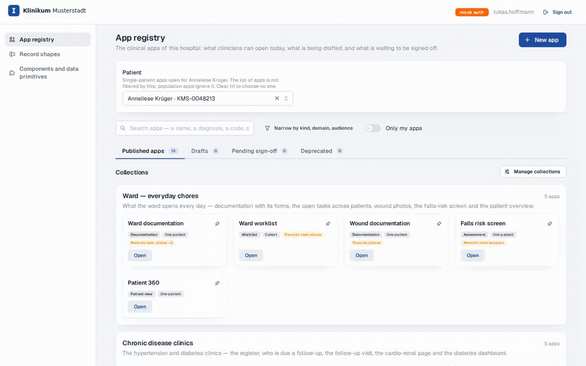

<sub>A recorded drafting session, replayed in the panel (`VITE_AGENT_MODE=replay`, see [Development](#development)) — the
assistant's replies and tool calls are the model's own, from a session against the synthetic record. The MP4 is
[here](docs/media/composer-replay.mp4).</sub>

> This is a prototype built for a research-hospital engagement and generalised for publication. It is a sample, not a
> medical device and not a production system: see [What this is not](#what-this-is-not) before you point it at real patients.

## Contents

- [What you get](#what-you-get)
- [How it works](#how-it-works)
- [Architecture](#architecture)
- [Screenshots](#screenshots)
- [Deploy](#deploy)
- [Customise the branding](#customise-the-branding)
- [Add a hospital](#add-a-hospital)
- [Connect a hospital's own FHIR server and PACS](#connect-a-hospitals-own-fhir-server-and-pacs)
- [Development](#development)
- [Tests](#tests)
- [Costs](#costs)
- [Security](#security)
- [What this is not](#what-this-is-not)
- [Repository layout and documentation](#repository-layout-and-documentation)
- [License](#license)

## What you get

- **A drafting assistant that fills a spec, not a page.** Claude on Amazon Bedrock (through [Strands Agents](https://strandsagents.com)) with fifteen typed tools — choose an archetype, set the app's settings, add roles, set governance, look up the codes the record actually uses, check readiness, compile a preview, record a refusal. The model never writes code or HTML; it fills an `AppSpec` that a JSON Schema validates on every call. Requests outside the catalogue — a risk score, an AI summary, an automatic therapy change — are refused with the reason recorded.
- **A closed catalogue.** 13 app archetypes (a longitudinal trend, a patient summary, a cohort register, a structured assessment, an imaging review, a disease dashboard from a guideline template, a worklist, a free-form composed page of 26 section kinds, …), 39 UI components, 22 data primitives (11 reads, 11 writes). A deterministic compiler turns a spec into a manifest; the same spec always gives the same manifest, and 43 golden fixtures hold it to that.
- **Writes to the record, by declared shape.** Observations with laterality and test conditions, problem-list and allergy entries, procedures, tasks, photo documentation, FHIR Questionnaires designed in the conversation and their responses (with answers extracted as Observations), and *record shapes*: reviewed, versioned form templates for goals, care plans, visits, notes and consent decisions, pinned by checksum.
- **Enforcement on the server.** A dispatcher Lambda resolves version → published → role → primitive → scope → declared configuration before any FHIR or DICOMweb request, writes one audit record per call (refusals included), and masks identity fields per role. The codes an app reads, its patient filter and its write rules are the published manifest's, not the request's; the browser is never trusted with data it was not granted.
- **A governed lifecycle.** Draft → in review → approved → published → deprecated, with a four-eyes rule (author ≠ approver), SHA-256 manifest versions, a KMS signature at approval, lineage when an app is iterated, and append-only events. Collections group apps for the launcher; an audit page and user management live in the panel.
- **One deployment per hospital, several per account.** Each hospital is a JSON file under `infra/hospitals/`; the CDK app makes a stage of it with its own user pool, registry, API and panel, its own branding (palette and logo, applied at boot without a build) and its own seed set of apps. EU data residency is checked at synthesis: a `us.` or `global.` inference profile does not deploy.
- **Reference servers, so it runs out of the box.** HAPI FHIR R4 and an Orthanc PACS on Fargate, seeded with a synthetic record (three patients, 189 resources, generated DICOM studies), an OHIF viewer on CloudFront reaching the PACS through a door that admits the panel's sign-in. Point the same deployment at a hospital's own servers with one block of configuration.
- **A panel that runs on your laptop with nothing in AWS.** Mock sign-in, an in-browser FHIR server with the same synthetic record, the bundled apps, and a replay of a recorded drafting session.

## How it works

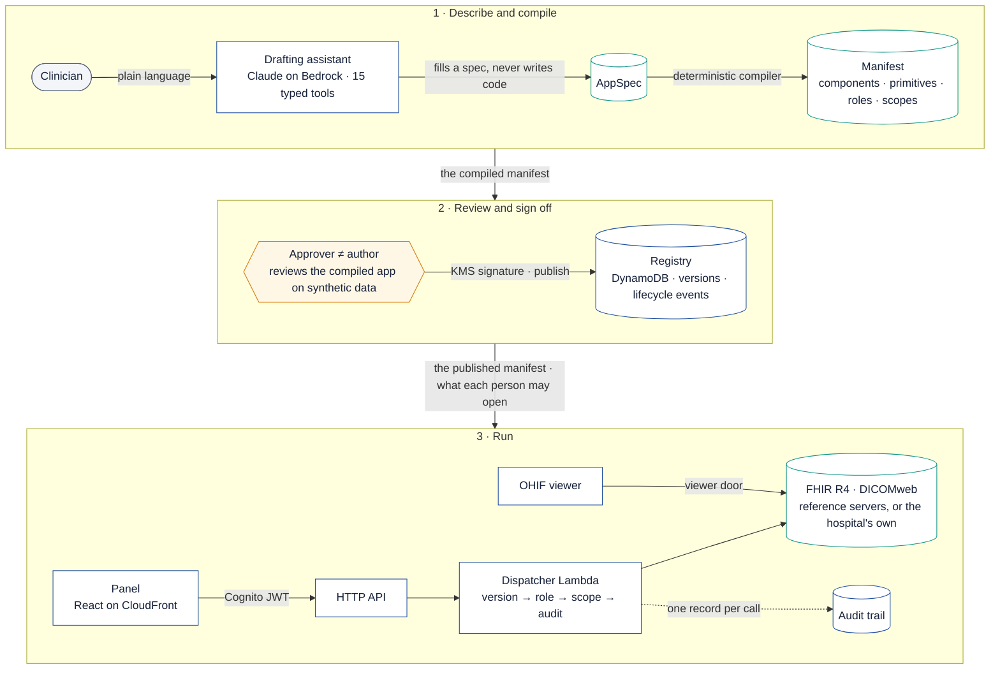

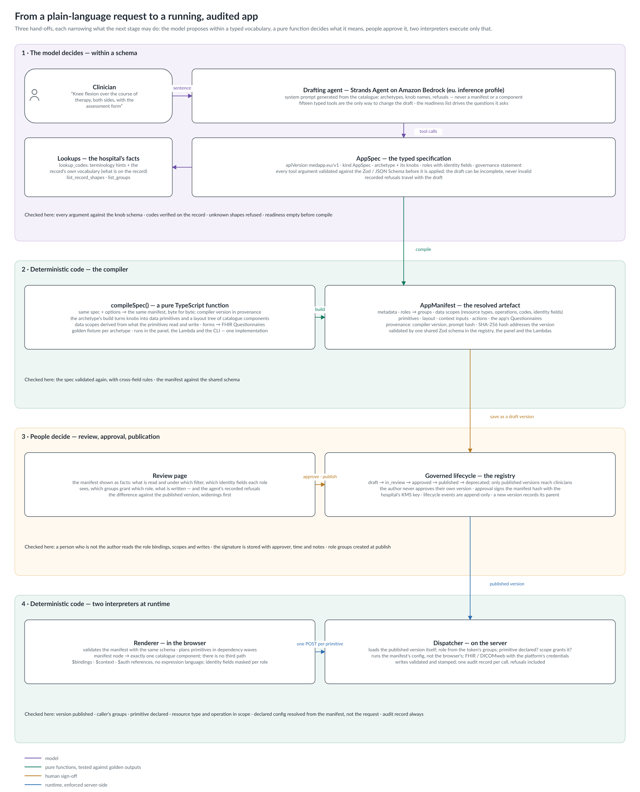

Three hand-offs, each with a different decider. The **assistant** proposes: it fills the spec through tools whose
arguments are validated against the catalogue, and asks when something is missing. The **compiler** decides what the app
is: a pure function from spec to manifest — layout tree of catalogue components, data primitives with their scopes,
roles mapped to Cognito groups, provenance. The **approver** decides whether it runs: a clinician who did not author the
version reviews the compiled app on synthetic data, reads the data categories and the purpose, and signs the manifest
hash with a hospital-held KMS key. Only then does the registry publish, create the app's role groups in the user pool
and write the app's own forms to the record.

At runtime nothing is interpreted: the renderer walks the manifest's layout and draws catalogue components, each bound
to the output of a named primitive. The dispatcher runs the primitive only if the manifest version is published, the
caller holds a role of that app, the role's scope allows the resource and operation, and the primitive's configuration is
the manifest's — then it records who asked for what, about whom, with which outcome.

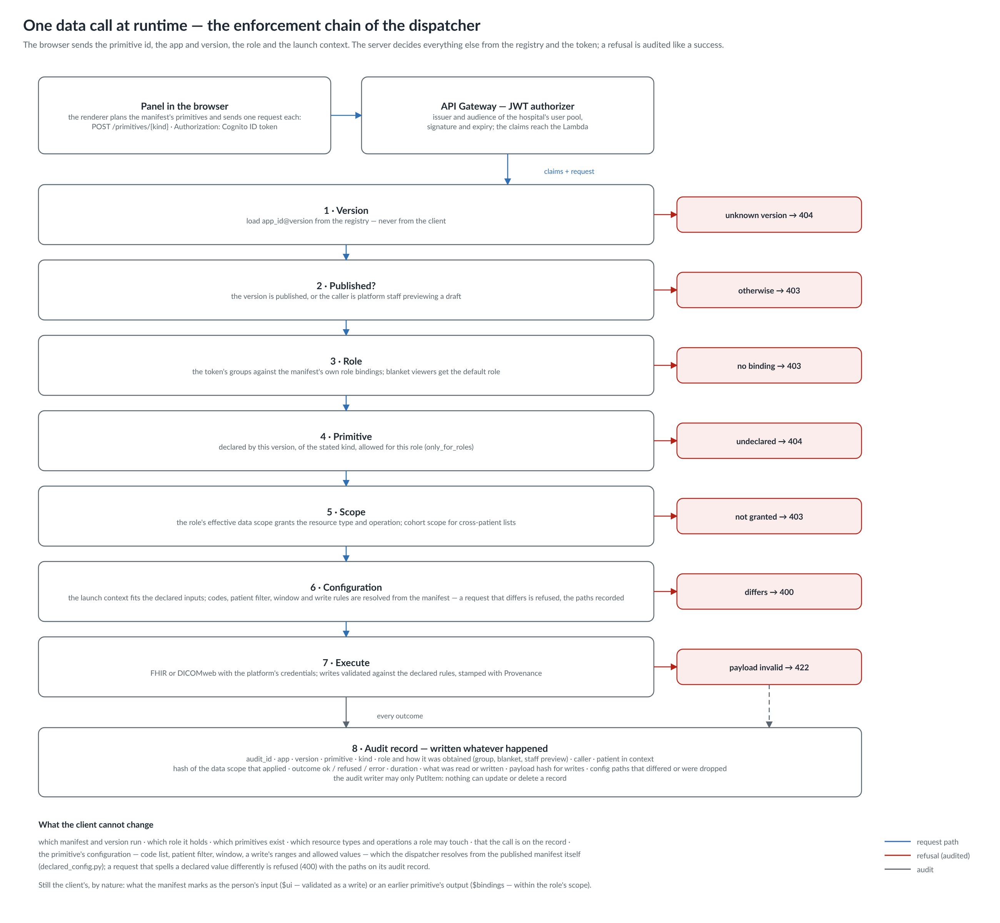

## Architecture

One hospital is one CDK stage of up to ten stacks in the hospital's own account and region. The browser talks only to
CloudFront, Cognito and API Gateway.

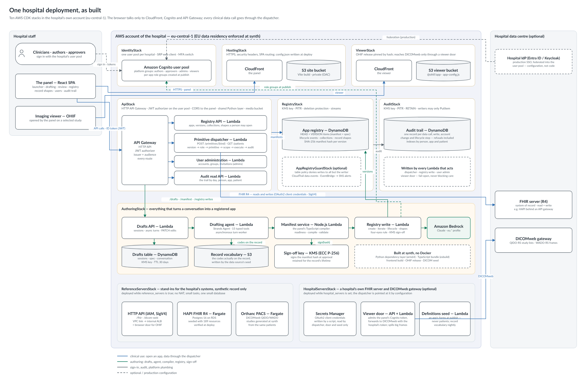

| Stack | What it holds |
|---|---|
| `IdentityStack` | One Cognito user pool per hospital; platform groups (authors, approvers, admins, viewers) and per-app role groups created at publish; invitation and recovery e-mails in the panel's look |
| `RegistryStack` · `AuditStack` | DynamoDB tables with customer-managed KMS keys, point-in-time recovery and `RETAIN`; the registry holds versions, lifecycle events, collections and record shapes; the audit table is append-only (PutItem-only policy) |
| `ApiStack` | HTTP API with a JWT authorizer; the dispatcher, the registry read API, user administration and the audit read API as Lambdas; the media bucket for photo documentation |
| `AuthoringStack` | The drafts API (async turns), the drafting agent (Strands on Bedrock, EU inference profiles only), the manifest service (the TypeScript compiler bundled as a Node Lambda), the registry writer (lifecycle, four-eyes rule, KMS sign-off), the record vocabulary the assistant searches |
| `HostingStack` · `ViewerStack` | The panel and the OHIF viewer, built at synthesis, served from private S3 behind CloudFront with security headers; the hospital's branding files under `/branding/` |
| `ReferenceServersStack` | HAPI FHIR R4 (Fargate + RDS Postgres) and Orthanc (Fargate) in a VPC without NAT, behind an IAM-authorised HTTP API with a browser door for the viewer; seeded with the synthetic record and verified at deploy |
| `HospitalServersStack` (optional) | The connection to a hospital's own FHIR server and DICOMweb gateway: OAuth 2.0 client credentials from Secrets Manager, a viewer door that swaps the user's token for the hospital's, a definitions-only seed |
| `AppRegistryGuardStack` (optional) | A resource policy that lets only the registry writer put items, CloudTrail data events, EventBridge → SNS alerts on denied or foreign writes |

The same deployment with the AWS service icons — the stacks, what talks to what, and the optional pieces (the registry
guardrails, a hospital's own servers, the hospital's identity provider federated into the user pool):

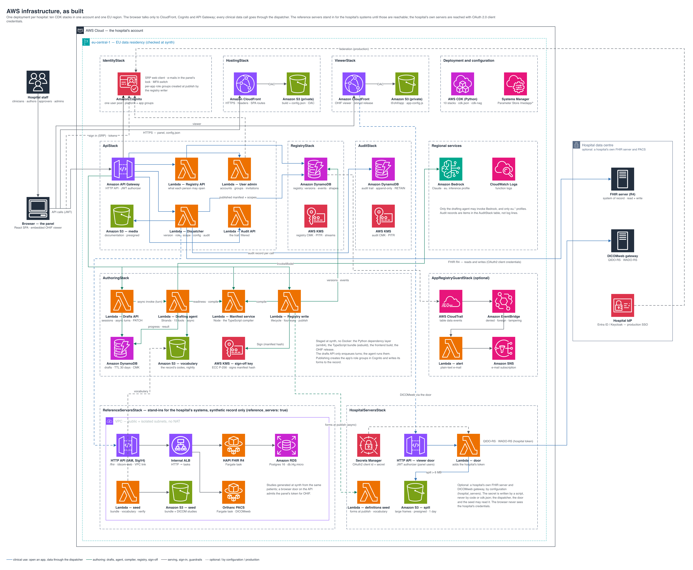

<sub>Editable: [`docs/diagrams/aws-infrastructure.drawio`](docs/diagrams/aws-infrastructure.drawio) (open in
[app.diagrams.net](https://app.diagrams.net)); generated from
[`aws_infrastructure_drawio.py`](docs/diagrams/aws_infrastructure_drawio.py), so it follows the stacks.</sub>

cdk-nag's AWS Solutions rules run on every synthesis; each accepted finding is in a register with its reason
([`infra/stacks/nag.py`](infra/stacks/nag.py)).

## Screenshots

The panel in mock mode with the shipped hospital's branding (Klinikum Musterstadt, an invented hospital; the people are
synthetic).

| | |
|---|---|
| 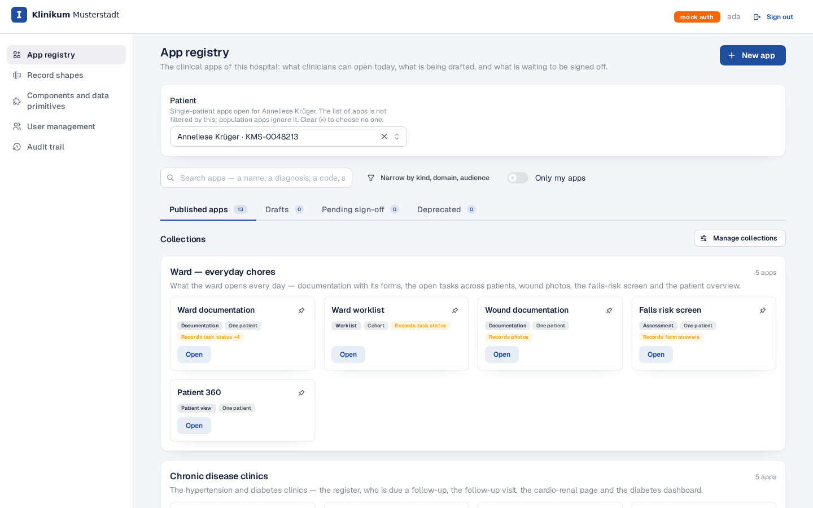 The launcher — the hospital's published apps in curated collections; staff also see drafts, pending sign-offs and deprecated versions | 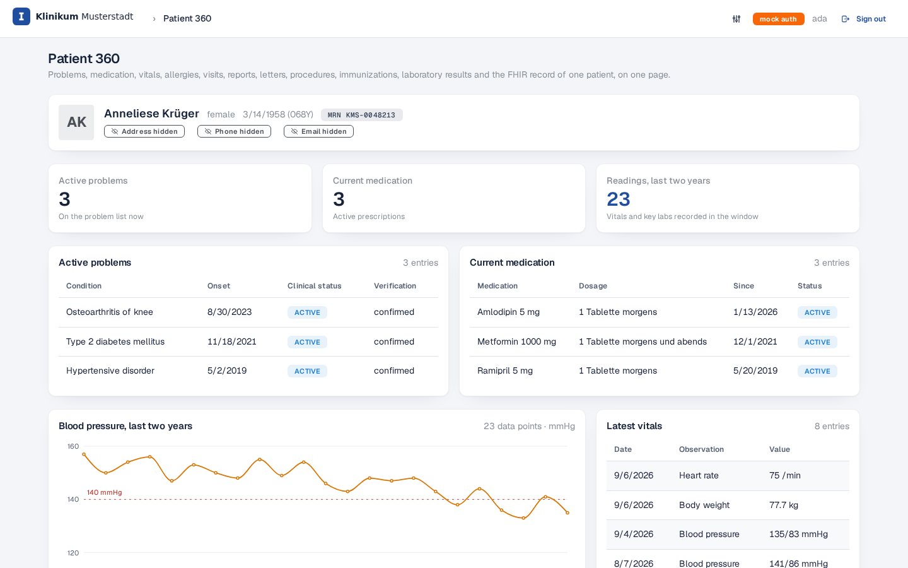 *Patient 360* — a composed page: headline counts, problems and medication, the blood-pressure trend against reference lines, latest vitals, visits, reports, letters |
| 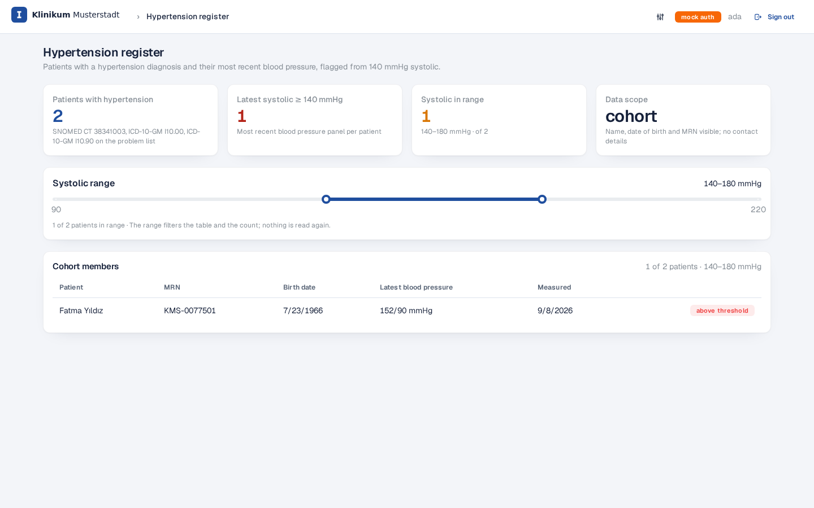 *Hypertension register* — a cohort by coded diagnosis (SNOMED or ICD-10-GM, whichever the record uses) with the latest blood pressure and a slider that narrows the register live | 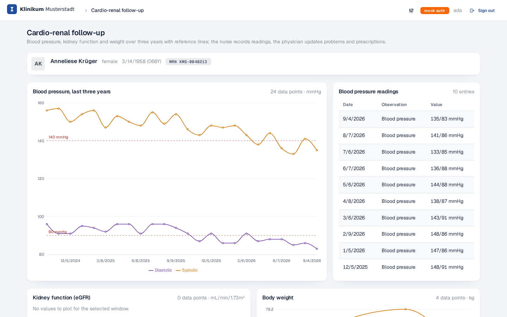 *Cardio-renal follow-up* — three series over three years with reference lines; the nurse records readings, the physician resolves problems and stops prescriptions, each write validated and attributed |
| 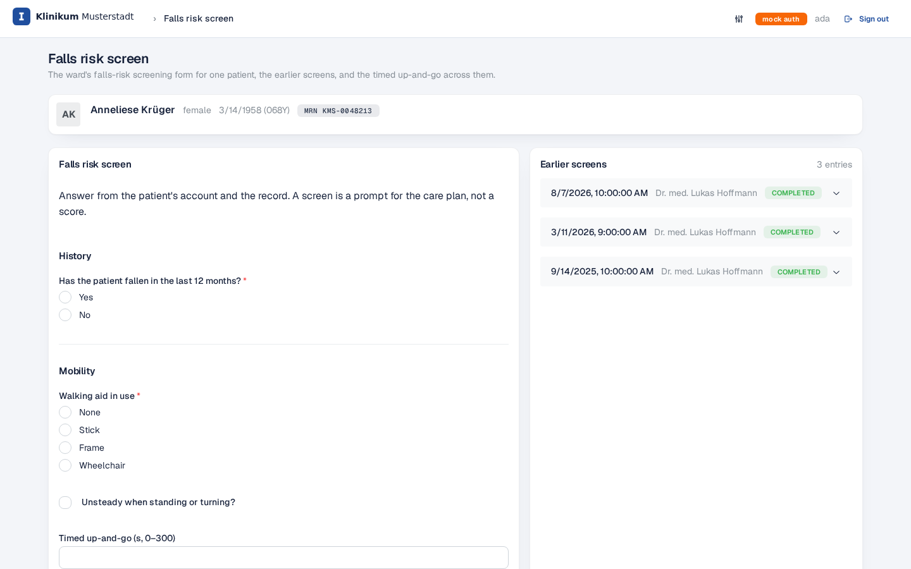 *Falls risk screen* — a form designed in the drafting conversation, compiled into a FHIR Questionnaire the app carries; earlier screens beside it, the timed up-and-go across them as a chart | 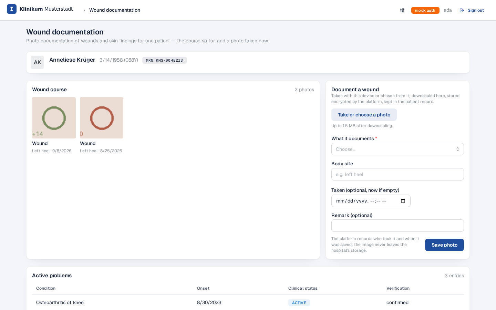 *Wound documentation* — photos taken with the device, downscaled in the browser, stored encrypted; the record keeps the Media |
| 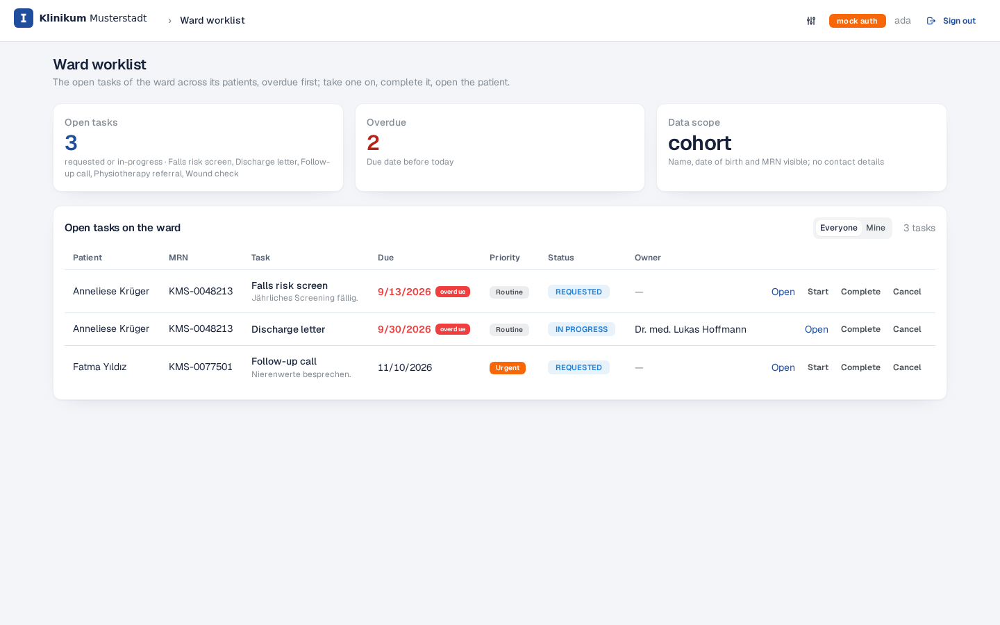 *Ward worklist* — open tasks across the ward's patients, overdue first, started and completed from the row with attribution | 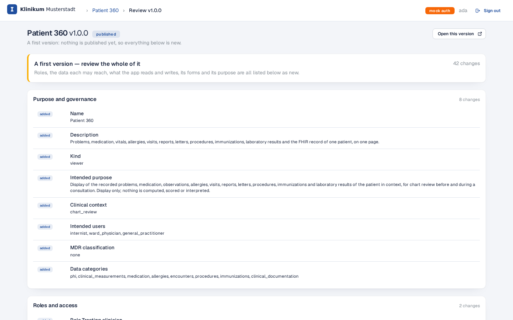 The review page — what an approver reads before signing: purpose, data categories, roles and their scopes, every change against the previous version |
| 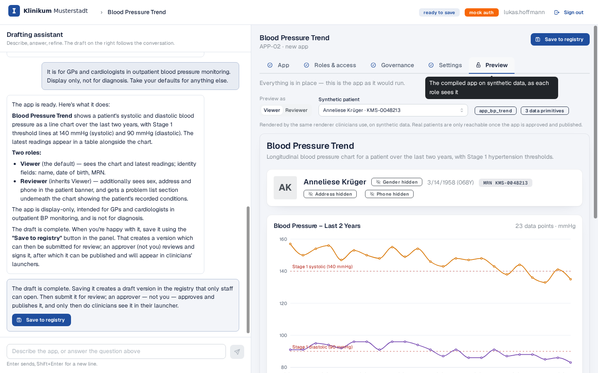 The drafting page — the conversation on the left, the structured draft on the right, and the compiled app previewed on synthetic data as each role sees it | 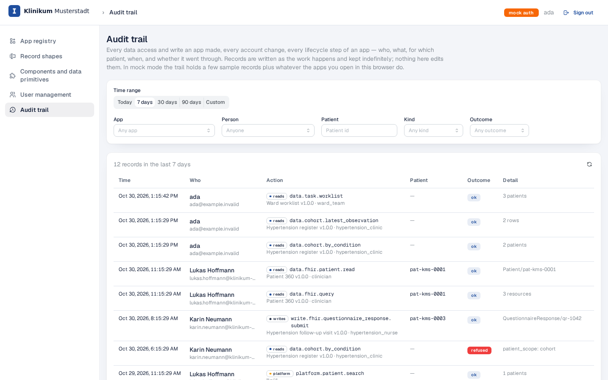 The audit trail — one record per data call, write, account change and lifecycle step, filtered by day, person, app, patient and outcome |
| 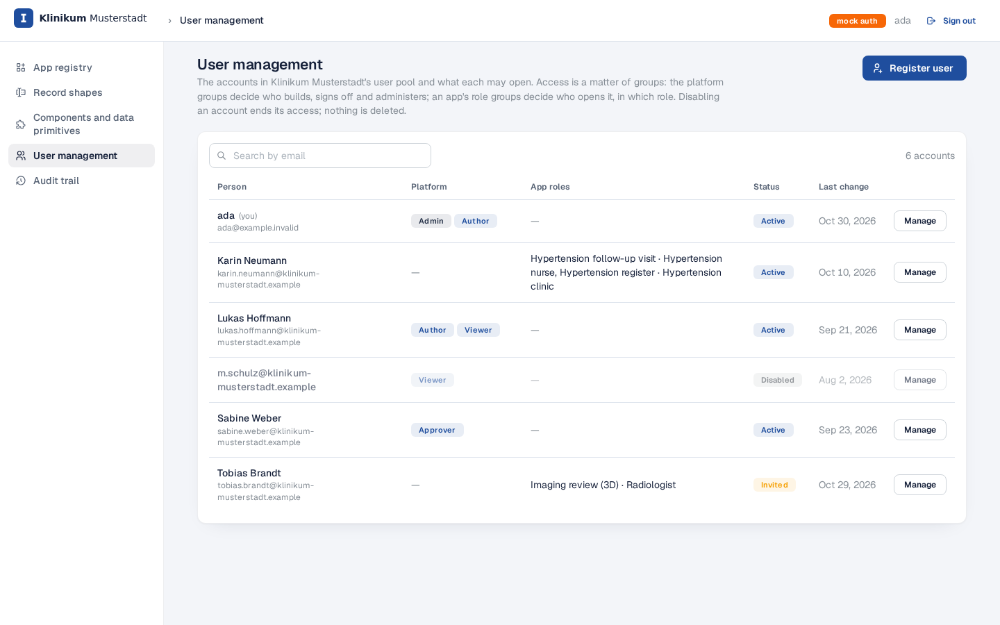 User management — accounts, platform groups and per-app role groups in the hospital's pool | 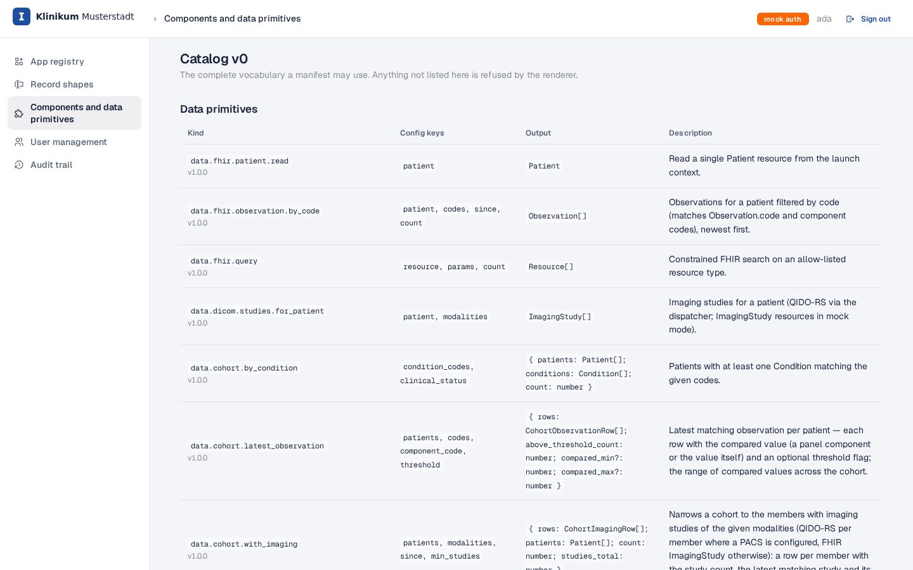 The catalogue — every component and data primitive a manifest may name; anything else is refused by the renderer |

More: the [sign-in screen](docs/media/sign-in.png), the [record-shape library](docs/media/shapes.png), the
[tumour board](docs/media/app-tumour-board.png), the [full Patient 360 page](docs/media/app-patient-360-full.png).

## Deploy

Prerequisites: an AWS account with [Amazon Bedrock model access](https://docs.aws.amazon.com/bedrock/latest/userguide/model-access.html)
to Anthropic Claude in an EU region (the shipped model id is `eu.anthropic.claude-sonnet-4-6`, an EU cross-region
inference profile; change it in the hospital file), Node 22, Python 3.12 or newer, Docker **not** required (every
Lambda is staged at synthesis), the AWS CDK CLI (`npm i -g aws-cdk`) and a bootstrapped environment
(`cdk bootstrap aws://<account>/eu-central-1`).

```bash
git clone https://github.com/aws-samples/sample-medical-app-builder.git
cd sample-medical-app-builder

# the panel is built at synthesis from med_app — install it first
(cd med_app && npm install)

cd infra
python3 -m venv .venv && source .venv/bin/activate
pip install -r requirements.txt -r requirements-dev.txt
pytest                                      # ~300 unit tests, no AWS needed

export AWS_PROFILE=<your profile> AWS_REGION=eu-central-1   # the CDK and the scripts below must agree on the account and region
cdk synth                                   # every hospital under hospitals/ — one today, Klinikum Musterstadt
cdk deploy 'hsp-musterstadt/*'              # ~20 minutes: the reference servers (VPC, RDS, Fargate) take most of it

export HOSPITAL_ID=hsp-musterstadt
scripts/create-user.sh you@example.org medapp-admins medapp-authors medapp-approvers   # the invitation e-mail carries a temporary password
scripts/seed-registry.py                    # the hospital's seed set (13 apps, 3 collections, 4 record shapes) → its registry, with the role groups
scripts/seed-reference.py                   # the synthetic record → the reference FHIR server; verified
```

The panel's URL is the `SiteUrl` output of `hsp-musterstadt-HostingStack`. Sign in with the invited account, open an
app from a collection, then **New app** to draft one — the assistant answers from Bedrock.

What `cdk deploy` reads: the hospital file [`infra/hospitals/hsp-musterstadt.json`](infra/hospitals/hsp-musterstadt.json)
(id, name, model, data residency, reference servers on, branding) and [`infra/cdk.json`](infra/cdk.json) (CDK feature flags
only). Stacks are named `<hospital_id>-<Stack>`; `cdk deploy '**'` deploys every hospital, `cdk destroy 'hsp-musterstadt/*'`
removes one (the registry, audit and drafts tables, their keys, the user pool and the media bucket are retained by design —
[`infra/README.md`](infra/README.md) says what to delete by hand before the same id deploys again).

## Customise the branding

A hospital's look is configuration, not code. The shipped hospital shows how — [`infra/hospitals/hsp-musterstadt.json`](infra/hospitals/hsp-musterstadt.json):

```json
"branding": {
  "palette": {
    "page": "#F3F5F9", "surface": "#FFFFFF", "ink": "#16213A", "muted": "#566274", "line": "#DDE3EC",
    "accent": "#1F4E9E", "data": "#D97706", "data2": "#7A4DB3", "data3": "#0E9488", "alert": "#B42318"
  },
  "logo": { "src": "logo.svg", "srcOnDark": "logo-on-dark.svg", "alt": "Klinikum Musterstadt", "height": 28, "hideName": true }
}
```

- **Palette** — any subset of the panel's ten colours as `#RRGGBB`; what you leave out keeps the defaults of
  [`med_app/src/branding.ts`](med_app/src/branding.ts). `accent` is the one colour with meaning (buttons, links, approved,
  in scope); `ink`, `muted`, `line`, `page`, `surface` are the neutral scale from text to background; `data`, `data2`,
  `data3` are chart series; `alert` marks thresholds, violations and refusals. Everything else — the Mantine theme and its
  colour scales, the CSS variables, the shadows, the sign-in screen — is derived.
- **Logo** — files in `infra/hospitals/<hospital_id>/` (SVG scales best): `src` for the top bar, `srcOnDark` for the dark
  sign-in panel, `hideName` when the wordmark already says the name. Replace the two sample SVGs with the hospital's own;
  make sure the file's box fits the artwork, since the panel scales the whole box to `height` and any empty canvas becomes a
  gap. (The sample wordmark is Geist outlined to paths — `docs/media/scripts/wordmark.py` — because an `` cannot use the
  page's web font and a `<text>` element would render at a different width on every platform.)
- **Checked at synthesis.** `cdk synth` refuses an unknown colour name, a non-hex value, a missing logo file — and a
  palette that would not read: the same WCAG contrast rules the panel's tests apply (text on page and cards ≥ 7:1, accent
  and alerts on white ≥ 4.5:1, light text on the dark panel, neutrals ordered dark to light) run on the merged palette,
  with the ratio reached and the one needed in the error message.
- **Applied at boot, no build.** The HostingStack serves the logo folder under `/branding/`, `config.json` carries the
  palette and logo as `VITE_BRANDING`, and the panel applies them before the first render. The user pool's e-mails take
  the palette too. One build of the panel serves every hospital.

To preview a look on the dev server, put the same JSON in `med_app/.env` as `VITE_BRANDING='{…}'` (single-quoted — dotenv
cuts an unquoted value at the first `#`) and the logo files under `med_app/public/branding/`.

## Add a hospital

1. Copy `infra/hospitals/hsp-musterstadt.json` to `infra/hospitals/<hospital_id>.json` (3–15 lowercase letters, digits
   and hyphens; it opens every resource name and never changes once deployed), edit the name, language (`en` | `de`),
   model id and branding; put the logo files in `infra/hospitals/<hospital_id>/`. Unknown keys fail the synthesis.
2. Give it a seed set: `med_app/showcase/<hospital_id>.yaml` names its apps by spec with the clinical note of an example
   sign-off and groups them into collections; `npm run showcase -- <hospital_id>` compiles the set into
   `med_app/manifests/<hospital_id>/`. Without one, the registry starts empty and every app is drafted.
3. `cdk synth -c hospitals=<hospital_id>` runs the residency check, the branding rules and cdk-nag on the new deployment
   alone; `cdk deploy '<hospital_id>/*'`; then the user and seed scripts with `HOSPITAL_ID=<hospital_id>`.

Account- and region-wide limits as hospitals accumulate: each `reference_servers: true` is a VPC (default quota 5 per
region), each guardrails stack a CloudTrail trail (5 per region), and all hospitals share the account's Lambda
concurrency and Bedrock quotas.

## Connect a hospital's own FHIR server and PACS

The reference servers stand in for a hospital's systems. A hospital with a FHIR R4 server and a DICOMweb gateway behind
OAuth 2.0 client credentials connects them with one block in its file and one secret:

```json
"hospital_servers": {
  "fhir_base_url": "https://fhir.hospital.example/fhir",
  "dicomweb_base_url": "https://fhir.hospital.example/dicom-web",
  "token_url": "https://auth.hospital.example/oauth2/token",
  "scope": "fhir/read fhir/write",
  "credentials_secret": "medapp/<hospital_id>/hospital-client",
  "dicom_patient_id": "resource_id"
}
```

`HOSPITAL_ID=<hospital_id> scripts/set-hospital-credentials.py` writes the client id and secret into Secrets Manager under
that name (prompted, never on the command line, never in the repository) before the first deploy; the dispatcher, the
viewer door and the definitions seed read it, nothing else. While the block is present the dispatcher and the viewer use
the hospital's servers and the reference servers serve the integration tests only. The drafting assistant then searches
the hospital record's own vocabulary — the codes and display texts actually on the record, refreshed nightly — so a request
naming "Kalium" or "Ferritin" resolves to what the record uses. [`infra/docs/hospital-servers.md`](infra/docs/hospital-servers.md)
has the setup, the verification steps, and what the first real hospital record taught the platform (no MRN, ICD-10-GM and
OPS codings, empty resource types, HAPI's search cache, gateway payload limits).

## Development

The panel on your laptop, nothing in AWS — mock sign-in, an in-browser FHIR server with the synthetic record, the bundled
apps, and the drafting page replaying a recorded session:

```bash
cd med_app
npm install
cp .env.example .env            # mock defaults; set VITE_AGENT_MODE=replay to see the drafting page answer
npm run dev                     # http://localhost:5173
```

Sign in as any name; groups ride on the username: `ada+medapp-admins,medapp-authors,medapp-approvers` holds the three
platform groups, `nurse+app-app_hypertension_follow_up-hypertension_nurse` one app's role. In mock mode the drafting chat
has no model: `VITE_AGENT_MODE=replay` plays back a recorded session turn by turn (the README's video;
[`med_app/src/authoring/replay/bp-trend.json`](med_app/src/authoring/replay/bp-trend.json)) — type anything, the script
answers in order — and the structured editor on the right works regardless. For the dev server against a deployment,
copy the stack outputs into `.env` as [`med_app/README.md`](med_app/README.md) describes.

The drafting agent has a terminal harness and an evaluation corpus of 48 conversations (English and German, buildable
requests and refusals) that run against Bedrock: [`infra/app_creator/README.md`](infra/app_creator/README.md).

## Tests

```bash
cd med_app && npm run typecheck && npm test      # ~440 vitest: manifests validate and render, compiler golden outputs, catalogue ↔ renderer, every seed app on the synthetic record
cd infra && pytest                               # ~300 pytest: every stack synthesises under cdk-nag, dispatcher enforcement, writes, the door, the seed, the agent with a scripted model
```

Integration tests run against a deployment and skip otherwise (`MEDAPP_FHIR_BASE_URL`, `MEDAPP_TEST_USER`, …). If you
change a spec under `med_app/specs/` or a seed set, run `npm run showcase` and commit the regenerated manifests; if you
change the catalogue, regenerate the schema the agent validates against (`npm run appspec -- schema --out docs/app-spec.schema.json`);
if you change the synthetic record, `npm run export:seed`.

## Costs

Indicative, eu-central-1, one hospital, light use. The **reference servers** dominate: two small Fargate tasks, a
`db.t4g.micro` RDS instance, an internal load balancer and a VPC link run continuously — roughly **90–130 USD a month**
(`cdk destroy hsp-musterstadt/ReferenceServersStack hsp-musterstadt/ViewerStack` removes them; a deployment connected to a
hospital's own servers does not need them). Everything else is serverless and near zero at rest: DynamoDB on demand,
Lambda, API Gateway, CloudFront, S3, KMS keys (about 1 USD each per month). **Drafting an app** costs model tokens only
while someone drafts: a pessimistic five-turn session is about 25 model invocations and ~450k input tokens — under 1 USD at
list price for Claude Sonnet, and a running app costs no model tokens at all, because apps are compiled, not generated at
runtime. Check [Amazon Bedrock pricing](https://aws.amazon.com/bedrock/pricing/) for the model you configure.

## Security

- **No secrets in the repository.** The hospital's OAuth client secret lives only in Secrets Manager; `infra/cdk.context.json`
  (CDK's lookup cache, which carries account ids) is ignored; `.env` files and evaluation transcripts are ignored.
- **Data residency at synthesis.** `data_residency: eu` refuses a region outside the EU and any model that would run
  inference outside it (`us.`, `global.`), and narrows the agent's Bedrock permissions to `eu-*`.
- **Least privilege, reviewed.** cdk-nag's AWS Solutions rules fail the synthesis on any finding not in the register;
  the register names every acceptance and its reason. Lambdas get explicit grants on named resources.
- **Enforcement on the server, audit of everything.** Role and scope checks, identity masking and refusals happen in the
  dispatcher, and so does the primitive's configuration: the dispatcher resolves the published manifest's declaration
  itself (code lists, patient filter, window, a write's ranges and allowed values) and executes that — a request that
  spells a declared value differently is refused with a 400 and the paths on its audit record
  (`infra/docs/dispatcher.md`, step 6). One audit record per call lands in an append-only table.

If you discover a potential security issue, please see [CONTRIBUTING](CONTRIBUTING.md#security-issue-notifications) —
do not open a public issue.

## What this is not

This is not a medical device and not a production system. It is a sample that demonstrates an architecture — a closed
catalogue, a deterministic compiler, server-side enforcement, a governed lifecycle — at the depth of a research prototype.

It has not been through a conformity assessment. The reference servers are single-region, single-AZ development
stand-ins. The synthetic record is anchored on a fixed date, so time-based views drift as the real clock moves on.

Anyone who deploys it with real patient data takes on that responsibility, the regulatory part included.

## Repository layout and documentation

One repository, three folders, deliberately not split: the infrastructure builds the panel at synthesis from `../med_app`,
bundles the spec compiler from `med_app/src/spec` into a Lambda, and its tests read the panel's manifests and fixtures.

| Folder | What it is | Start with |
|---|---|---|
| [`infra/`](infra/) | The AWS CDK app (Python): the stacks, the Lambdas, the drafting agent (`app_creator/`), shared code, operational scripts, unit and integration tests, the hospital files | [`infra/README.md`](infra/README.md) |
| [`med_app/`](med_app/) | The panel (Vite + React + Mantine, TypeScript): launcher, app runtime, drafting page, review, users, audit; the manifest schema and renderer; the catalogue; the AppSpec compiler and its CLI; the seed sets (`showcase/` → `manifests/`); the design system | [`med_app/README.md`](med_app/README.md) |
| [`docs/`](docs/) | The diagrams and the scripts that draw them; the README's screenshots and video and the scripts that recorded them | [`docs/diagrams/README.md`](docs/diagrams/README.md) |

| Document | Covers |
|---|---|
| [`infra/docs/dispatcher.md`](infra/docs/dispatcher.md) | Enforcement order, primitives, `FhirSource` and the DICOMweb source, audit records, errors |
| [`infra/docs/reference-servers.md`](infra/docs/reference-servers.md) | The HAPI + Orthanc stand-ins, the generated DICOM seed, the OHIF viewer and its configuration |
| [`infra/docs/hospital-servers.md`](infra/docs/hospital-servers.md) | Connecting a hospital's own FHIR server and PACS: credentials, the viewer door, the definitions-only seed, what a real record looks like |
| [`infra/docs/identity.md`](infra/docs/identity.md) | The user pool, platform and per-app groups, who sees which apps, federation |
| [`infra/docs/audit.md`](infra/docs/audit.md) | The audit trail: what is recorded by whom, the append-only table, the read API, retention |
| [`infra/docs/registry-table.md`](infra/docs/registry-table.md) | The app registry: item shapes, lifecycle, immutability guardrails |
| [`infra/docs/drafting-api.md`](infra/docs/drafting-api.md) | Drafting sessions, the async turn protocol, the manifest service, registry writes |
| [`infra/docs/hosting.md`](infra/docs/hosting.md) | The panel on CloudFront, the synth-time build, `config.json`, branding |
| [`infra/app_creator/README.md`](infra/app_creator/README.md) | The drafting agent: draft, tools, catalogue, prompts, the evaluation corpus and harness |
| [`med_app/docs/application-catalog.md`](med_app/docs/application-catalog.md) | What can be built: archetypes, components, primitives, terminology hints, refusals |
| [`med_app/docs/app-spec.md`](med_app/docs/app-spec.md) | The AppSpec the agent fills and the compiler turns into a manifest |
| [`med_app/docs/example-prompts.md`](med_app/docs/example-prompts.md) | What to say to the assistant, and what it declines |

## License

This library is licensed under the MIT-0 License. See the [LICENSE](LICENSE) file.
